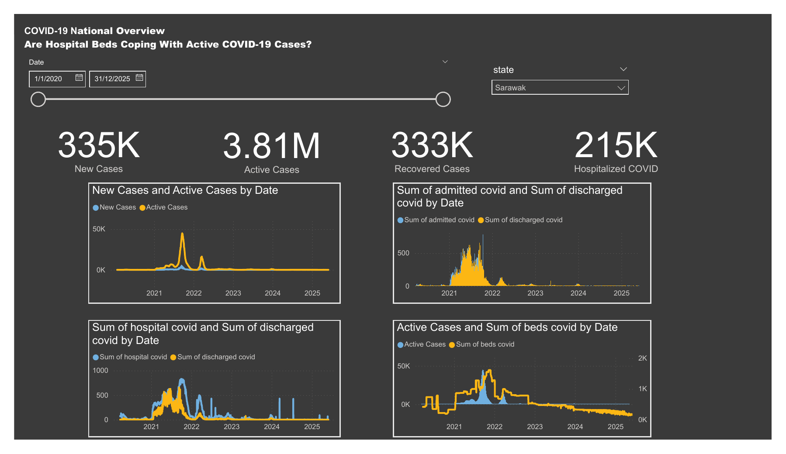
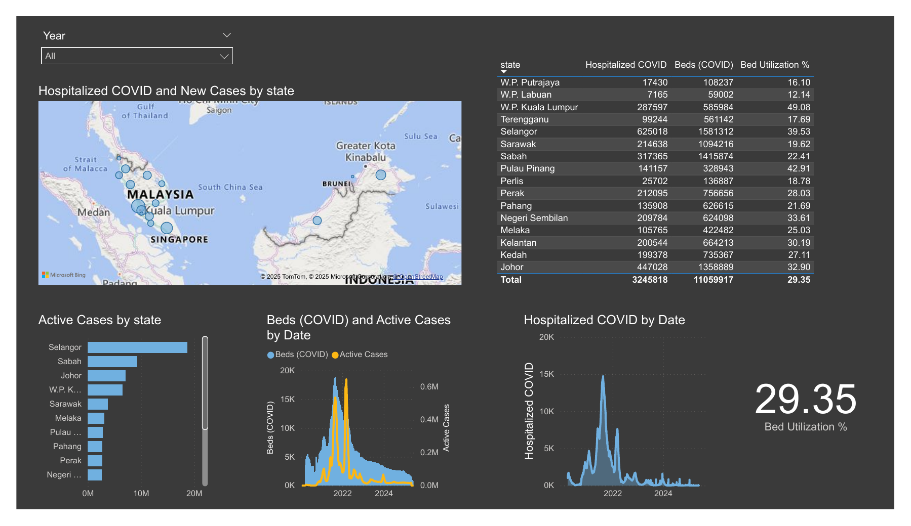
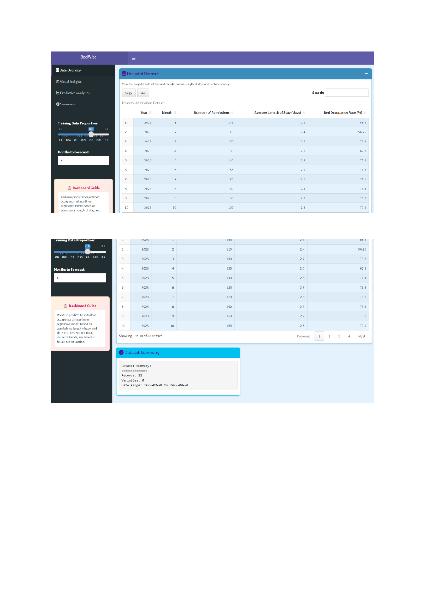
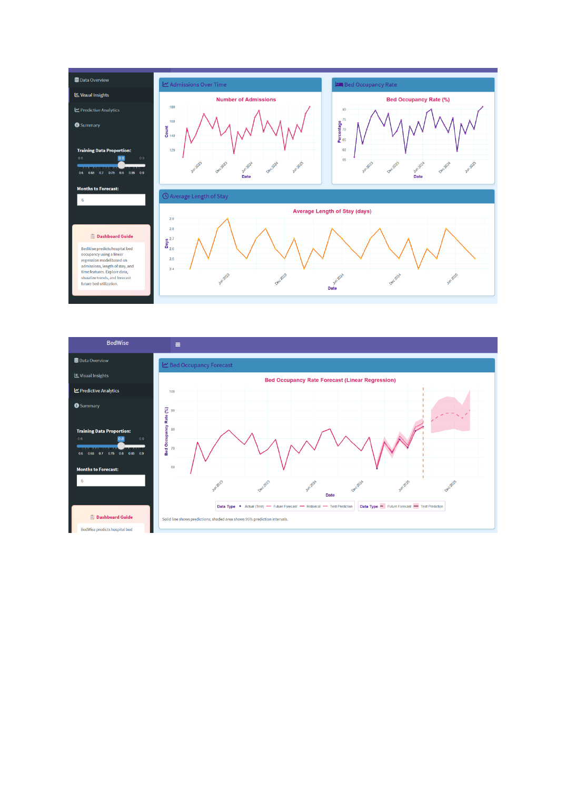
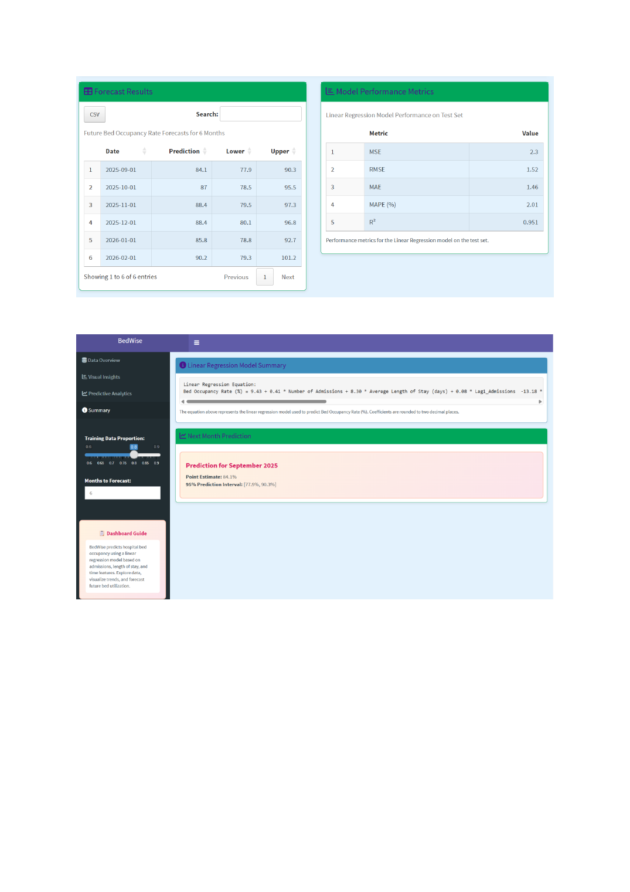

# Data-Driven Insights on COVID-19 and Hospital Capacity

**MDIT x DOSM Datathon 2025 | DATA PHANTOMS**

A team project exploring the relationship between COVID-19 case trends and hospital capacity in Malaysia. The project combines a two-page Power BI report with a separate R Shiny prototype for exploring hospital indicators and demonstrating bed-occupancy forecasting using a sample dataset.

> **Project scope:** The Power BI dashboard analyses historical COVID-19 and hospital records. The BedWise Shiny application is a separate prototype that uses a small dummy hospital dataset. It is not connected to the Power BI data or to live hospital systems.

## Project at a glance

- **Competition:** Malaysia Data Innovation Talent x DOSM Datathon 2025
- **Team:** DATA PHANTOMS (4 members)
- **Institution:** Department of Mathematics and Statistics, Faculty of Science, Universiti Putra Malaysia
- **Submission date:** 21 September 2025
- **Main tools:** Microsoft Power BI, R, Shiny, dplyr, ggplot2, DT, lubridate

## Problem statement

The project examines how COVID-19 case trends relate to hospital admissions, discharges, hospitalised COVID-19 patients and COVID-designated bed capacity across Malaysian states. The intended use is to support historical monitoring, comparison between states and discussion of hospital resource planning.

## Project components

### 1. Power BI dashboard

The Power BI report contains two pages:

1. **National Overview** - date and state filters, headline COVID-19 indicators, daily case trends, admissions and discharges, hospitalised COVID-19 patients and COVID-designated beds.
2. **State-level Analysis and Bed Capacity vs Cases** - state comparison, a map, state-level case indicators, hospitalised COVID-19 counts, bed capacity and the dashboard's bed-utilisation measure.

#### National Overview



#### State-level Analysis



Files are in [`power-bi-dashboard/`](power-bi-dashboard/):

- `Dashboard.pbix` - editable Power BI Desktop report.
- `Dashboard.pdf` - exported report pages for quick viewing.
- `data/` - the two source CSV files supplied with the project.
- `assets/` - preview images used in this README.

### 2. BedWise: R Shiny predictive analytics prototype

BedWise is a separate R Shiny application with four sections:

- **Data Overview** - displays the sample hospital dataset and a dataset summary.
- **Visual Insights** - charts admissions, bed-occupancy rate and average length of stay over time.
- **Predictive Analytics** - fits a linear regression model, displays test-set predictions and prediction intervals, and forecasts future bed-occupancy values.
- **Summary** - displays the fitted model equation and the next-month prediction.

The app allows the user to change the training-data proportion and the number of forecast months. The supplied screenshot shows an example run with a six-month forecast. In that screenshot, the app reports MSE 2.30, RMSE 1.52, MAE 1.46, MAPE 2.01% and R-squared 0.951. These are results from the displayed demo run on the sample dataset, not validated performance on real hospital data.

#### Data overview



#### Visual insights and forecast



#### Forecast results and model summary



Files are in [`bedwise-shiny-app/`](bedwise-shiny-app/):

- `app.R` - Shiny application source code. The original machine-specific CSV path has been changed to a repository-relative path so the app can be run from this folder.
- `data/dummy_hospital_data_2023_2025.csv` - 32 monthly sample records from January 2023 to August 2025.
- `screenshots/` - screenshots and the original screenshot PDF.

## Methodology described in the project report

The report describes the following workflow:

1. Collect daily COVID-19 case records and hospital-capacity records.
2. Convert date fields, inspect missing or inconsistent values, and review unusual observations.
3. Join the case and hospital records by date and state.
4. Explore case trends, hospital utilisation and state-level differences.
5. Present the results in an interactive Power BI report.

The report also discusses derived indicators such as bed utilisation, seven-day moving averages and lag variables.

## Selected findings reported by the team

The project report and Power BI export highlight the following results:

- The dashboard displays a national bed-utilisation ratio of **29.35%**.
- The state table displays **49.08%** for W.P. Kuala Lumpur, **42.91%** for Pulau Pinang and **39.53%** for Selangor.
- The report states that increases in new cases typically preceded increases in hospitalisations by 7-14 days. This finding is reported in the document, but the supplied files do not include the analysis code needed to reproduce the lag calculation.
- The report describes daily new-case peaks above 33,000 and active-case peaks above 323,000.

These are project-reported results, not claims of a live hospital monitoring system. The exact calculation and interpretation of each KPI should be checked against the Power BI measures before reuse in further analysis.

## Data sources and coverage

| Dataset | Records | Coverage in supplied files | Notes |
|---|---:|---|---|
| COVID-19 cases | 33,218 | 25 Jan 2020 - 31 May 2025 | Includes state-level records and a national `Malaysia` row. |
| Hospital capacity | 29,765 | 24 Mar 2020 - 31 May 2025 | Daily state-level hospital and COVID-bed records. |
| BedWise sample data | 32 | Jan 2023 - Aug 2025 | Small sample dataset supplied for the Shiny prototype; it is not the official daily COVID/hospital dataset. |

See [`power-bi-dashboard/data/README.md`](power-bi-dashboard/data/README.md) for source links and attribution.

## Running the BedWise app

1. Install R and RStudio.
2. Install the required packages:

```r
install.packages(c(
  "shiny", "shinydashboard", "shinyjs", "dplyr",
  "ggplot2", "DT", "lubridate"
))
```

3. Set the working directory to `bedwise-shiny-app/`.
4. Run:

```r
shiny::runApp()
```

## Important limitations and validation notes

- **Historical data only:** the supplied COVID and hospital datasets end on 31 May 2025. The date slicer visible in the Power BI export extends to 31 December 2025, but that does not mean the supplied data contains observations through December 2025.
- **National row:** the COVID-19 file includes a `Malaysia` national aggregate in addition to state/federal-territory records. Do not sum the national row together with state rows, or cases will be double-counted.
- **Negative active-case values:** the supplied COVID-19 CSV contains 1,283 negative values in `cases_active` (minimum -630). The report says anomalies were corrected, but the supplied CSV still contains these values. Review the Power Query transformations or document the cleaning procedure before describing this CSV as cleaned.
- **Bed-utilisation interpretation:** the Power BI export shows totals of 3,245,818 for `hosp_covid` and 11,059,117 for `beds_covid`; their ratio is 29.35%. This reproduces the displayed total but should not automatically be described as the arithmetic mean of daily occupancy rates. Confirm the DAX measure and aggregation before making that interpretation.
- **Predictive app data:** BedWise uses the supplied dummy/sample monthly dataset, not the official daily hospital dataset. Its forecasts are a prototype demonstration, not operational hospital predictions.
- **Forecast assumptions:** the current R code carries the last observed admissions and average length-of-stay values forward when generating future occupancy predictions. Forecasts therefore depend on a constant-input assumption for those predictors.
- **Model metric:** the current R code floors the displayed R-squared calculation at zero. A negative test-set R-squared would therefore be hidden. Consider using the conventional unbounded R-squared calculation before relying on the metric for model comparison.
- **Model descriptions:** the report mentions ARIMA/LSTM in its analytical-layer discussion, while the supplied BedWise R code implements linear regression. This repository describes the implementation visible in the supplied code; it does not claim that ARIMA or LSTM code is included.
- **No live decision support:** the original dashboard README states that the Power BI report is for analytical and visualisation purposes, not real-time operational decision-making.

## Team

DATA PHANTOMS:

- Al Iqhbal Haziq bin Kasuma Wangi
- Giridarkanna A/L Vijaykhanna
- Puovelan A/L Kumaresan
- Shamalan A/L Vicneswaran

**Advisor:** Dr. Ahmad Hakiim bin Jamaluddin, Department of Mathematics and Statistics, Universiti Putra Malaysia.


## Repository structure

```text
MDIT-x-DOSM-Datathon-2025/
|-- README.md
|-- report/
|   `-- DATA_PHANTOMS_Datathon2025_Report.pdf
|-- power-bi-dashboard/
|   |-- Dashboard.pbix
|   |-- Dashboard.pdf
|   |-- README.md
|   |-- assets/
|   `-- data/
|       `-- README.md
`-- bedwise-shiny-app/
    |-- app.R
    |-- README.md
    |-- data/
    `-- screenshots/
```

## Reuse and attribution

The source datasets retain their upstream attribution and usage terms. The repository does not assign an open-source licence to the team-authored report, Power BI file or R application. Please contact the project contributors before reusing those materials.
